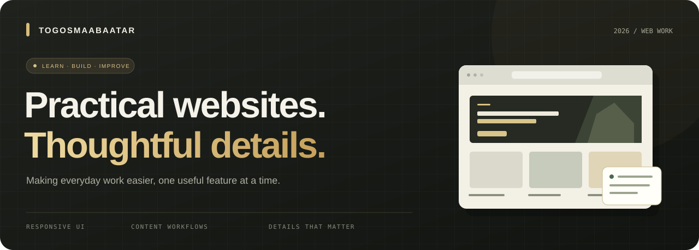
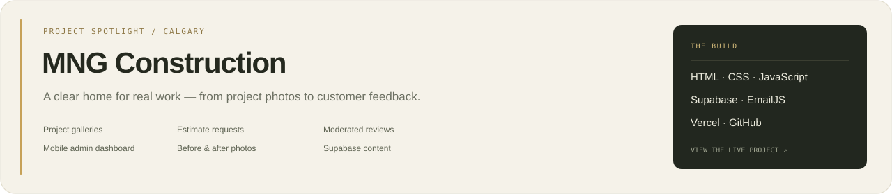

**Building useful web experiences. Learning through real projects.**

[Explore the featured project](https://mng-construction.vercel.app) · [Browse my repositories](https://github.com/togosmaabaatar?tab=repositories)

 

## A little about this space

This is where I share projects, things I’m learning, and the small improvements that make a website easier to use.

I’m interested in clear interfaces, mobile-friendly layouts, and tools that let people manage their own content.

 

## Project spotlight

A website for a Calgary company working in landscaping, siding, roofing and snow removal. The project brings together a photo portfolio, estimate requests and a Supabase-backed content workflow.

**Explore:** [Live website](https://mng-construction.vercel.app)

 

## Working with

| Front end | Content & services | Shipping |
| :--- | :--- | :--- |
| HTML · CSS · JavaScript | Supabase · EmailJS | GitHub · Vercel |
| Responsive layouts and accessible forms | Auth, project photos and moderated reviews | Version control and hosted previews |

 

## Current focus

- **Make it clear** — simple navigation and readable content.
- **Make it useful** — forms and dashboards connected to real workflows.
- **Make it dependable** — validate input, check permissions and test behavior.

 

---

Thoughtful details. Practical progress. · 2026

