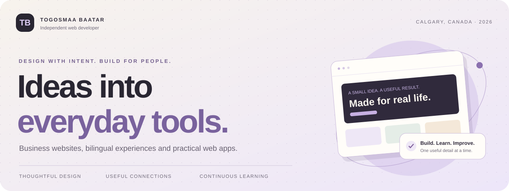
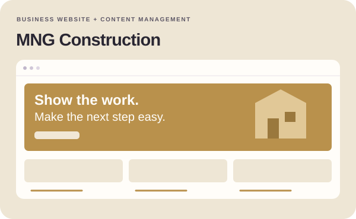
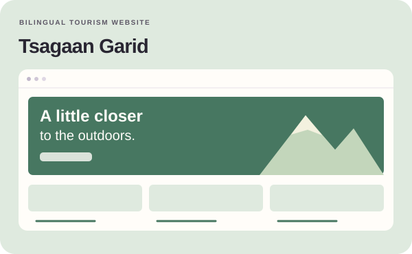
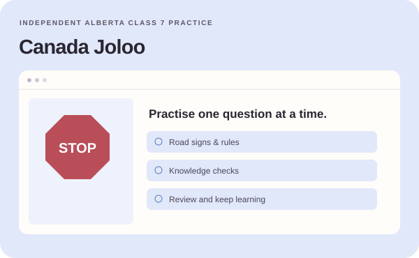
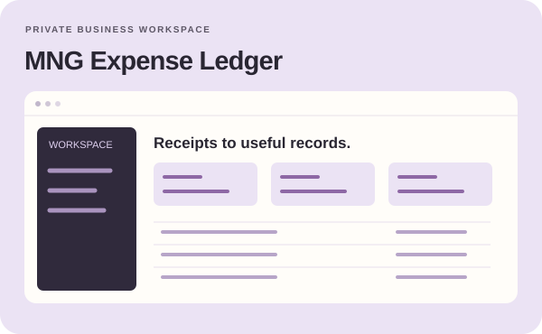
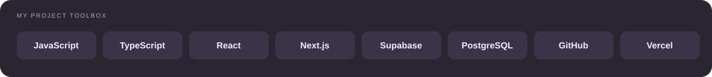
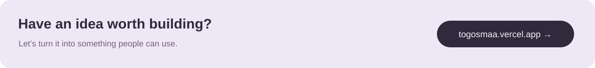

**Independent web developer · Calgary, Canada · English & Mongolian**

I build clear business websites and practical apps, from the first layout to the workflows behind it.

**[Explore my portfolio ↗](https://togosmaa.vercel.app/)** &nbsp; · &nbsp; **[Browse the work](#selected-work)** &nbsp; · &nbsp; **[Say hello](mailto:togosmaabaatar@gmail.com)**

 

## A little about me

Hi, I’m **Togosmaa**. I enjoy turning a business idea or a repetitive task into something simple to use. My work brings together visual design, responsive interfaces and services that connect the experience to real content.

I’m building and improving projects in construction, tourism, learning and business administration. Each one is a chance to learn, test real interactions and make the next version better.

| What I care about | What that means in practice |
| :--- | :--- |
| **Clarity** | Readable content, straightforward navigation and a clear next step |
| **Everyday usefulness** | Forms, content tools and workflows that help people get things done |
| **Thoughtful details** | Mobile layouts, validation, accessible controls and appropriate access rules |

 

## Selected work

<table>
<tr>
<td width="50%" valign="top">

<h3>MNG Construction</h3>

A Calgary company website prototype with project galleries, estimate requests, moderated reviews and a mobile-friendly admin dashboard.

HTML · CSS · JavaScript · Supabase · EmailJS

<a href="https://mng-construction.vercel.app/"><strong>Explore website ↗</strong></a>

</td>
<td width="50%" valign="top">

<h3>Tsagaan Garid</h3>

A six-page tourism website with English and Mongolian content, designed to make the destination and visitor information easy to explore.

HTML · CSS · JavaScript · Bilingual content

<a href="https://tsagaan-garid.vercel.app/"><strong>Explore website ↗</strong></a> · <a href="https://github.com/togosmaabaatar/camp">Source</a>

</td>
</tr>
<tr>
<td width="50%" valign="top">

<h3>Canada Joloo</h3>

An independent learning and practice project for Alberta Class 7 knowledge, bringing road signs, questions and review into one place.

JavaScript · Learning content · Responsive UI

<a href="https://canada-joloo.vercel.app/"><strong>Try the app ↗</strong></a> · <a href="https://github.com/togosmaabaatar/Canada-Joloo">Source</a>

</td>
<td width="50%" valign="top">

<h3>MNG Expense Ledger</h3>

A private business workspace for AI-assisted receipt processing, expense tracking and reporting. Built around the day-to-day work behind a business.

Next.js · React · TypeScript · Supabase · Gemini

<strong>Private workspace</strong> · Customer data stays private

</td>
</tr>
</table>

Project visuals above are original interface illustrations. Follow the links to explore the actual public projects.

 

**The home for all my work → [togosmaa.vercel.app](https://togosmaa.vercel.app/)**  
My bilingual portfolio brings together selected projects, my approach and ways to get in touch. [View its source](https://github.com/togosmaabaatar/portfolio).

 

## From interface to working product

| Interface | Connected workflows | Delivery |
| :--- | :--- | :--- |
| HTML, CSS, JavaScript & TypeScript | Supabase Auth, PostgreSQL & Storage | Git & GitHub |
| React & Next.js | Edge Functions & EmailJS | Vercel previews & production |
| Responsive layouts & accessible forms | Server-side AI integrations | Browser checks & input validation |

These are tools I use in my projects, with the stack chosen to suit the work.

 

## Currently building better

- **Content management:** simpler ways for owners to upload projects, arrange photos and publish updates.
- **Customer conversations:** useful estimate forms, feedback moderation and clear contact options.
- **Business tools:** less manual administration, with careful handling of access and private data.

<strong>Behind the build: MNG Construction</strong>

 

A visitor browses published projects, sends an estimate request or leaves a review. The owner manages projects and photos, approves feedback and replies from a separate admin dashboard.

| Visitor action | Connected workflow |
| :--- | :--- |
| Explore completed work | Published projects and photos from Supabase |
| Request an estimate | A guided form connected to EmailJS |
| Leave feedback | A validated submission awaiting moderation |
| Read customer experiences | Approved reviews with owner replies |

Access rules separate public content from administrative actions. The goal is a website the owner can keep up to date without editing code.

<strong>Монгол хэлээр · Миний тухай</strong>

 

Сайн байна уу, би Тогосмаа. Канадын Калгари хотод байрладаг, бизнесийн вебсайт болон өдөр тутмын ажлыг хялбарчлах веб апп хөгжүүлдэг.

Аялал жуулчлал, барилга, сургалт, бизнесийн удирдлагын төслүүд дээр ажиллаж байна. Хэрэглэхэд ойлгомжтой бүтэц, гар утсанд тохирсон дизайн, бодитоор ажиллах холбоос, маягт, удирдлагын хэсэгт анхаардаг. Бодит төсөл дээр ажиллан суралцаж, хийсэн зүйлсээ тогтмол сайжруулж байна.

Хамтран ажиллах санаа байвал [portfolio](https://togosmaa.vercel.app/) үзэх эсвэл [имэйлээр](mailto:togosmaabaatar@gmail.com) холбогдоорой.

 

**[Portfolio](https://togosmaa.vercel.app/)** &nbsp; · &nbsp; **[Email](mailto:togosmaabaatar@gmail.com)** &nbsp; · &nbsp; **[Public repositories](https://github.com/togosmaabaatar?tab=repositories)**

Thoughtful design. Useful connections. Continuous learning.

